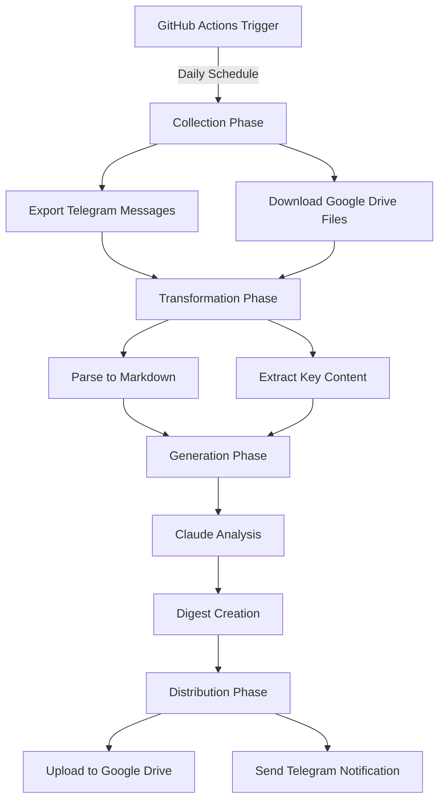

# Architecture Overview

## System Design

Synapse Pipeline is a **stateless batch processing system** that generates daily team coordination digests by collecting, transforming, and synthesizing communication data from multiple sources.

## Core Components

### Data Collection Layer
- **Telegram Exporter**: Fetches messages from configured channels via Telegram API
- **Google Drive Downloader**: Retrieves meeting notes and documents from shared folders

### Transformation Layer  
- **Telegram Transformer**: Converts raw message data into structured markdown
- **Document Parser**: Extracts relevant content from meeting notes

### Generation Layer
- **Digest Generator**: Uses Claude to synthesize insights from combined data sources

### Distribution Layer
- **Google Drive Uploader**: Publishes digests to shared team folder
- **Telegram Notifier**: Sends digest summaries to team channels

## Data Flow

## Implementation

The system uses a modular CLI architecture (`src/synapse/`) with clear separation of concerns:
- **Exporters** - Data collection from external sources
- **Transformers** - Data parsing and formatting
- **Uploaders** - Distribution to Google Drive
- **Notifiers** - Telegram notifications

Each component is independently testable and reusable. The CLI commands are orchestrated by GitHub Actions for automated daily runs.

## Key Design Decisions

### Stateless Architecture
The pipeline operates without persistent state between runs. Each execution:
- Fetches data from a fixed time window (e.g., last 24 hours)
- Processes all content as new
- Generates a complete digest

**Trade-off**: Simplicity over efficiency. No state management complexity, but may reprocess content.

### External Tool Integration
- **Telegram**: Uses telethon library for robust API access
- **Google Drive**: Uses rclone CLI for reliable file operations
- **Claude**: Invokes via CLI for flexibility

**Rationale**: Leverages battle-tested tools rather than reimplementing functionality.

## Configuration Strategy

The system uses a two-tier configuration approach:
- **Sensitive data**: Environment variables for API keys and credentials
- **Non-sensitive settings**: TOML configuration file for channel IDs and folder paths

This separation allows the configuration file to be version-controlled while keeping secrets secure.

## Deployment Model

### Automated Execution
Primary deployment via GitHub Actions with scheduled triggers. The CI/CD pipeline handles credential management through GitHub Secrets.

### Manual Execution
CLI tools available for debugging and ad-hoc runs. Both MVP script and modular CLI support manual operation.

## Security Architecture

- **Credential isolation**: Secrets never stored in code or config files
- **Least privilege**: Service accounts limited to specific resources
- **Audit trail**: All operations logged for compliance
- **Rotation support**: Credentials can be updated without code changes